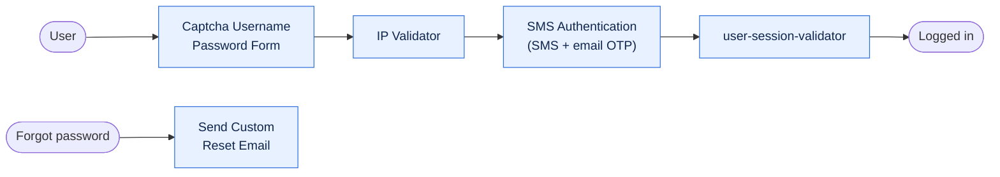

<div align="center">

# Keycloak 2FA (SMS + Email OTP) and Login Security SPIs

**Login hardening for Keycloak: OTP by SMS and email, IP and country allow-lists, a captcha login form, single-session enforcement, and password-reset email through an HTTP email API.**

[](https://adoptium.net/)
[](#compatibility)
[](LICENSE)

</div>

---

## What is this?

Keycloak's browser login is a pipeline of **authenticator steps**. This project adds five extra steps to that
pipeline. They ship together as a single JAR, `keycloak-remiges-spi`, and appear in the admin console next to
the built-in steps. You mix and match them in any authentication flow.

Everything an operator would want to change (message wording, sender address, OTP length, limits, proxy,
gateway credentials) is a field in the admin console. Changing it never needs a rebuild.



## The five steps

| Step in the admin console | Provider id | What it gives you |
|---|---|---|
| **SMS Authentication** | `sms-authenticator` | A one-time code sent by SMS and by email, with expiry, wrong-attempt limit, resend limit and an optional remember-device cookie |
| **IP Validator** | `ip-validator` | Allow login only from whitelisted IPs, ranges or IPv6 addresses, and optionally only from one country (MaxMind GeoIP) |
| **Captcha Username Password Form** | `captcha-u-p-form` | The standard login form plus a captcha checked against your own validation API. The username and password can arrive AES-encrypted from the login page |
| **Send Custom Reset Email** | `reset-credential-email-custom` | The password-reset link delivered through Netcore (or compatible) email API instead of the realm SMTP settings, with a response that does not reveal whether a user exists |
| **user-session-validator** | `user-session-validator` | One active session per user. A second login asks whether to end the older session |

## Highlights

- **Configured in the console.** Every text, sender and limit is a field with an inline example. Blank fields fall back to safe defaults.
- **Message templates.** Write `{code}`, `{brandingName}`, `{ttlMinutes}` and other placeholders in SMS, email and screen messages. Values in HTML email are escaped.
- **Two delivery channels in one step.** The OTP goes to the phone and to the mailbox at once.
- **Gateway friendly.** The SMS text keeps its exact spacing by default so it keeps matching a DLT-registered template (India).
- **Proxy aware.** SMS and email calls can be sent through an HTTP proxy.
- **Safe logging.** The OTP, gateway password, reset links and captcha answers are never logged. Phone numbers and emails are masked.
- **Test mode.** Simulation mode plus a fixed OTP lets automated tests log in without sending anything.

## Documentation

| Guide | Read it to |
|---|---|
| [Installation](docs/installation.md) | Build the JAR, deploy it, add the GeoIP database, run in Docker |
| [Architecture](docs/architecture.md) | Understand how the pieces fit together and how a config value is resolved |
| [SMS Authentication](docs/sms-authentication.md) | Set up and operate the SMS and email OTP step |
| [IP Validator](docs/ip-validator.md) | Restrict logins by IP, range or country |
| [Captcha Login Form](docs/captcha-login-form.md) | Add a captcha and encrypted credentials to the login page |
| [Custom Reset Email](docs/custom-reset-email.md) | Send password-reset mail through an HTTP email API |
| [Session Validator](docs/session-validator.md) | Enforce one session per user |
| [Configuration Reference](docs/configuration-reference.md) | Every field, every placeholder, every default |
| [Security](docs/security.md) | What is protected, what is not, and what to switch off in production |
| [Troubleshooting](docs/troubleshooting.md) | Symptom, cause and fix |
| [Development](docs/development.md) | Code layout, how to add a new step, release checklist |

The admin-console field reference also lives next to the code in [`keycloak-spis/README.md`](keycloak-spis/README.md).

## Quick start

```bash
# 1. Build
cd keycloak-spis
mvn clean install                      # -> target/keycloak-remiges-spi-22.0.7.jar

# 2. Deploy
cp target/keycloak-remiges-spi-22.0.7.jar /opt/keycloak/providers/
/opt/keycloak/bin/kc.sh build          # required, or the steps do not appear

# 3. Restart Keycloak
```

Then in the admin console: **Authentication > Flows > duplicate "browser" > Add step > SMS Authentication**,
set it to **Required**, open its gear icon and fill in the email API, SMS gateway and OTP rules.
The [SMS Authentication guide](docs/sms-authentication.md#set-it-up) walks through every click.

> **Try it safely first.** Turn on **Testing: Simulation Mode** and set **Testing: Fixed OTP** to `123456`.
> Nothing is sent, and you can log in with that code. Turn both off before production.

## Compatibility

| | Version |
|---|---|
| Java | 11 or newer |
| Maven | 3.8 or newer |
| Keycloak libraries compiled against | 22.0.4 |
| Keycloak in the supplied `Dockerfile` | 26.0.2 |

The JAR is compiled against Keycloak 22.0.4 and the Dockerfile deploys it on 26.0.2. Test each step on the exact
Keycloak version you run. The remember-device option uses Keycloak 22 classes, so keep it off on Keycloak 26.
Details are in [Installation](docs/installation.md#compatibility-notes).

## Repository layout

```
.
├── README.md
├── LICENSE                         Apache License 2.0
├── docs/                           the guides listed above
└── keycloak-spis/                  the Maven project
    ├── pom.xml
    ├── Dockerfile
    └── src/main/
        ├── java/co/remiges/tech/
        │   ├── Constants.java      config keys, defaults, placeholder names
        │   ├── smsservice/         SMS Authentication step and SMS gateway client
        │   ├── emailservice/       email API client and the custom reset-email step
        │   ├── ipcheckservice/     IP whitelist and GeoIP validation
        │   ├── captchaservice/     captcha login form
        │   ├── usersession/        single-session validator
        │   └── util/               config, template, branding and masking helpers
        └── resources/
            ├── META-INF/services/  registers the five authenticator factories
            ├── theme-resources/    login.ftl, email templates, English messages
            └── theme/              email-code-theme
```

## License

Released under the [Apache License 2.0](LICENSE).
