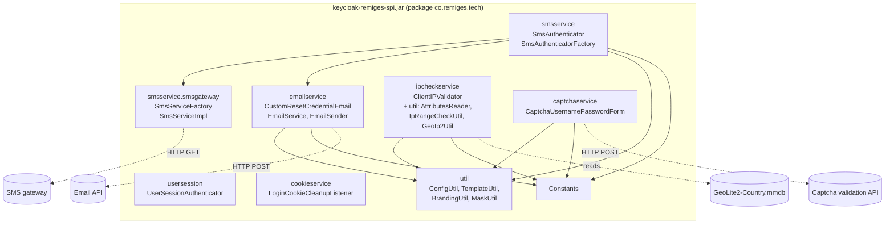
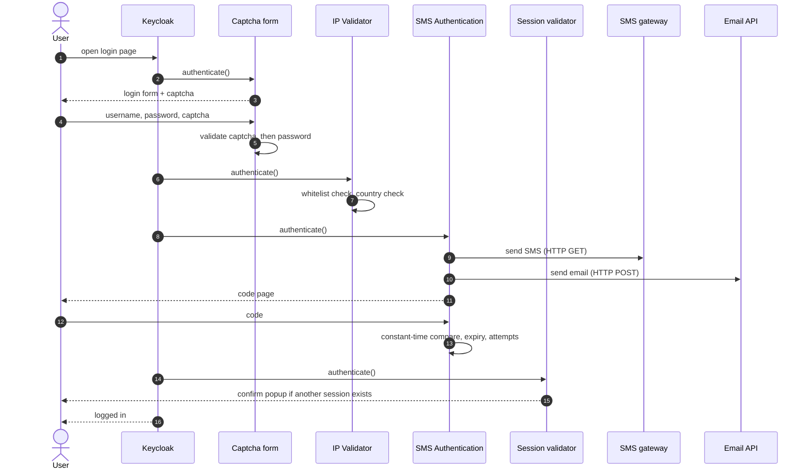

# Architecture

How the suite is put together, and the rules that apply to all five steps.

## Keycloak concepts used

| Concept | Meaning here |
|---|---|
| **Authenticator** | One step in a login flow. It has `authenticate()` (show the page) and `action()` (handle the submitted form) |
| **AuthenticatorFactory** | Creates the step and describes it to the admin console: name, help text, settings fields |
| **Authentication flow** | An ordered list of steps. You build yours by duplicating the built-in `browser` flow |
| **Authentication session** | Short-lived per-login storage. Steps keep "notes" in it, such as the OTP |
| **Service provider file** | `META-INF/services/org.keycloak.authentication.AuthenticatorFactory` lists the five factories so Keycloak finds them. `META-INF/services/org.keycloak.events.EventListenerProviderFactory` lists the cookie cleanup listener |
| **Event listener** | Code that Keycloak calls for events such as `LOGIN`. It is not a step in a flow and is switched on per realm under Events |

## Component map

## Packages

| Package | Responsibility |
|---|---|
| `co.remiges.tech` | `Constants`: every config key, default text and placeholder name in one place |
| `smsservice` | The OTP step. Generates, sends, validates and rate-limits codes |
| `smsservice.smsgateway` | `ISmsService` interface, `SmsServiceFactory` (returns a no-op logger in simulation mode, the real client otherwise), `SmsServiceImpl` (the HTTP GET client) |
| `emailservice` | `EmailService` (HTTP client for the email API), `EmailSender` (sender details and API format), `CustomResetCredentialEmail` (the reset step) |
| `ipcheckservice` | The IP step, plus `util` classes that read attributes, compare IP ranges and look up countries |
| `captchaservice` | The captcha form. Extends Keycloak's `UsernamePasswordForm` |
| `usersession` | The single-session step |
| `cookieservice` | Event listener that expires the login-attempt cookies after a completed login |
| `util` | Small helpers shared by all steps |

## How a setting is resolved

Every text and limit follows the same rules, implemented in `ConfigUtil`.

1. The admin console saves a cleared field as an empty string. **A blank or whitespace-only value counts as "not set".**
2. If the value is not set, the **default in `Constants`** is used.
3. For a few fields a **fallback chain** applies, for example the OTP email sender name:
   `OTP Email: Sender Name` → `Branding: Name` → (empty).
4. `Branding: Name` itself falls back to the **realm display name**, then the **realm name** (`BrandingUtil`).

Because of rule 2, upgrading the JAR is safe. A saved config that lacks a newly added field simply uses the default.

## Message templates

Texts such as the SMS, the email subject and body, and on-screen lines are templates (`TemplateUtil`).

- A placeholder is written `{name}`, for example `{code}`.
- A placeholder is only filled when that field lists it. The list for each field is in the
  [Configuration Reference](configuration-reference.md#placeholders).
- An unknown placeholder is **left as typed** and a warning is logged. A typo never breaks a login.
- A `null` value renders as empty text.
- In **HTML email bodies** every value is HTML-escaped (`& < > " '`). The template itself is trusted, because an administrator wrote it.

## The login flow end to end

The order above is a recommendation. Steps are independent, and each one can be used on its own.
Put the **session validator after the OTP step**, see [Security](security.md#order-of-steps).

## State kept in the authentication session

The OTP step stores these notes for the duration of one login attempt:

| Note | Content |
|---|---|
| `code` | The generated OTP, stored as plain text until used or expired |
| `ttl` | Expiry time as epoch milliseconds |
| `length` | Configured OTP length, reused when a new code is generated |
| `invalidOtpCount` | Wrong codes entered so far |
| `resendOtpCount` | Resends requested so far |
| `resendOtpLimit` | Configured resend limit |
| `resendOtpBloackTime` | Moment the resend limit was hit (the name keeps its original spelling) |
| `rememberMe` | Whether Remember Me was ticked |

These notes disappear with the authentication session. Nothing is written to the Keycloak database by this project.

## Dependencies on Keycloak at runtime

The code uses `keycloak-server-spi`, `keycloak-server-spi-private`, `keycloak-core` and `keycloak-services`.
Keycloak provides them at runtime. The project adds `ipaddress`, `geoip2` and `maxmind-db` itself, which is
why those JARs must sit next to it in `providers/`.

## Error handling approach

- Failures that the user can fix show a message on the page (wrong code, expired code, wrong captcha).
- Failures on the server side (gateway down, email API error) log the cause and show a generic error page. The exception text is never shown to the user.
- A reset request answers the same way for unknown users, so the page cannot be used to discover accounts.
