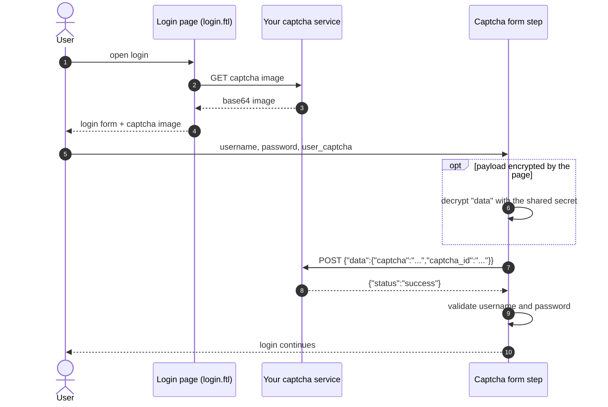

# Captcha Login Form

Provider id `captcha-u-p-form`, shown as **Captcha Username Password Form**.
Class: `co.remiges.tech.captchaservice.CaptchaUsernamePasswordForm`.

It **replaces** Keycloak's standard "Username Password Form". The user must type a captcha before the username
and password are even checked. The captcha itself is generated and verified by **your own service**, not by Google reCAPTCHA.

## How it works



1. The login page loads a captcha image from your service.
2. The user submits the form with the captcha text in the field `user_captcha`.
3. If the page sent the credentials encrypted, the step decrypts them first.
4. The step POSTs the captcha to your **validation URL**. Only a response with `"status": "success"` passes.
5. On success the standard Keycloak username and password check runs. On failure the login page returns with the "wrong captcha" message.

If `user_captcha` is empty, the captcha counts as wrong. The password is not checked.

## Set it up

1. **Authentication > Flows**, in your browser-flow copy, click **Add step**, choose **Captcha Username Password Form**, and remove the built-in **Username Password Form**. This step allows only the **Required** requirement.
2. Click its gear icon and fill in the three fields below.
3. Install `login.ftl` in your login theme (see [The login page](#the-login-page)).
4. In **Realm settings > Security defenses > Content-Security-Policy**, remove `frame-src 'self';` if your captcha needs it.
5. Bind the flow as the browser flow.

## Settings

| Field | Key | Meaning |
|---|---|---|
| Captcha API: Validation URL | `validateCaptchaAPI` | The service that checks the captcha. Example `https://rta.example.com/validate_captcha` |
| Message: Wrong Captcha | `incorrectCaptchaMsg` | Text shown on the login page. Example `Incorrect captcha, please try again` |
| Login Page: Credentials Encryption Secret | `captchaEncryptionSecret` | Secret shared with the login page script. Stored masked |

## Validation API contract

The step sends one HTTP **POST** with `Content-Type: application/json`. The body is built with a JSON writer,
so quotes typed by a user cannot change its structure.

Request:

```json
{
  "data": {
    "captcha": "A7X9K",
    "captcha_id": "b3f1c0e2"
  }
}
```

| Field | Source |
|---|---|
| `captcha` | The text the user typed, form field `user_captcha` |
| `captcha_id` | Form field `captcha_secret`, which the login page should fill with the id returned when it loaded the image. Empty string if missing |

Response the step accepts as valid:

```json
{ "status": "success" }
```

Anything else, an HTTP error, or an unreachable service counts as a wrong captcha, and the failure is logged.

## The login page

`src/main/resources/theme-resources/templates/login.ftl` is a **sample** login page. It:

- shows the usual username, password, remember-me and forgot-password controls,
- loads a captcha image from a fixed address with `fetch`, and
- adds the text field `user_captcha`.

Before using it, change these three things in the file:

| What | Why |
|---|---|
| The captcha image URL (`http://localhost:8081/unified-portal/api/auth/captcha`) | It points to a development server |
| Add a hidden field `captcha_secret` with the id your service returns | The sample page does not send it, so the validation request has an empty `captcha_id` |
| The registration link (`saralsanchar.gov.in`) | It belongs to another project |

The page uses the Keycloakify / `common/keycloak` theme components (`parent=keycloak`, `import=common/keycloak`).
Use it as a base for your own theme rather than as a drop-in file.

## Encrypted credentials (optional)

The page may encrypt the username and password so they are not sent as plain form fields. If the form contains
**both** `data` and `s`, the step decrypts them and checks the decrypted username and password **directly**. The plain
`password` field is not needed and the login page does not post it. If either is missing, the step logs a warning and uses the plain
fields. The sample `login.ftl` does not include the encryption script, so this part is for pages that add it.

The step keeps the decrypted values in its own copy of the form data. It does not write them back into the request,
because Keycloak 26 returns a fresh copy of the request form on every call and the values would be lost.

| Form field | Content |
|---|---|
| `data` | Hex string of the AES-GCM ciphertext of a JSON object, for example `{"username":"..","password":".."}` |
| `s` | Hex string of the random salt |

Decryption details the page script must match:

| Parameter | Value |
|---|---|
| Key derivation | PBKDF2-HMAC-SHA256, 100,000 rounds, 256-bit key |
| Password for the key | The **Credentials Encryption Secret** |
| Salt | The bytes of `s` |
| Cipher | AES-256-GCM, 128-bit tag, no padding |
| IV | 16 zero bytes |
| Plaintext | JSON object. Each key and value is copied into the form, so `username` and `password` reach Keycloak |

Limits that protect the server: `data` may be at most 4096 hex characters and `s` at most 128. Larger payloads are rejected,
because each decryption runs 100,000 PBKDF2 rounds.

If the **Credentials Encryption Secret** is blank, the step falls back to a **built-in legacy secret** and logs a warning.
Set the secret in the console and in the page script. They must be identical.

> **What this protects.** The secret is visible in the page's script, so this hides the credentials from network
> observers and logs only. It does not hide them from the user's own browser. Always serve the login page over https.
> The fixed zero IV is also weaker than a random IV, because the same input with the same salt gives the same output.

## What the user sees

| Situation | Result |
|---|---|
| Captcha right, password right | Login continues |
| Captcha wrong or empty | Login page again with the configured message, password not checked |
| Decryption fails or payload too big | Login fails with invalid credentials |
| Captcha service unreachable | Treated as a wrong captcha |

## Logging

The decrypted JSON and its values are never logged. Only the names of injected fields are logged at debug level,
and decryption failures log the exception type only.
