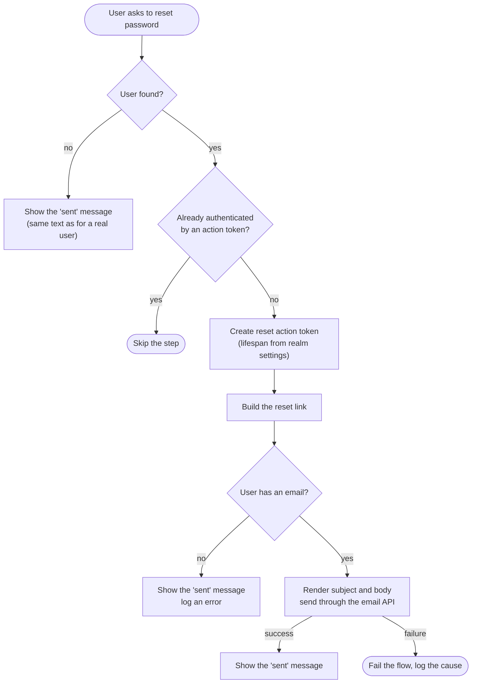

# Custom Reset Email

Provider id `reset-credential-email-custom`, shown as **Send Custom Reset Email**.
Class: `co.remiges.tech.emailservice.CustomResetCredentialEmail` (extends Keycloak's `ResetCredentialEmail`).

It replaces the built-in "Send Reset Email" step of the **Reset credentials** flow. The reset link is sent through an
HTTP email API such as Netcore, instead of the realm's SMTP settings (**Realm settings > Email**).

## How it works



The reset token lifetime is the realm's own setting, **Realm settings > Tokens > Action token generated by user**.
This step does not add its own lifetime field.

## Set it up

1. **Authentication > Flows**, open **Reset credentials** (or its copy).
2. Replace **Send Reset Email** with **Send Custom Reset Email** (Add step, then remove the original). Only the **Required** requirement is offered.
3. Click its gear icon, fill in the fields, and save.

## Settings

| Field | Notes |
|---|---|
| Branding: Name | Fills `{brandingName}`. Blank uses the realm display name, then the realm name |
| Email API: URL / Key / Format | Same as the OTP email, see [Email API formats](sms-authentication.md#email-api-formats) |
| Reset Email: Sender Name | Blank uses Branding: Name |
| Reset Email: Sender Address | **Required.** No email is sent while it is empty. Must be on a verified domain |
| Reset Email: Provider Tag | Blank uses the sender name |
| Reset Email: Subject | Placeholders `{brandingName}` `{firstName}` `{lastName}` `{username}` |
| Reset Email: Body | HTML. Adds `{link}`. **Keep `{link}`**, without it the user cannot reset |
| Message: Reset Email Sent | Shown after the request |
| User Attribute: Email | Name of the attribute holding the address. Default `email` |
| Network: Use Proxy / Proxy Host / Proxy Port / Skip TLS Verification | As for the OTP step |

### Defaults

Subject: `Reset Credentials for {brandingName}`

Body:

```html
<html><body><p>Dear {username},</p><p>Please click on the link below to reset your password:</p>
<a href='{link}' style='padding: 10px; background-color: #007BFF; color: white; text-decoration: none; border-radius: 5px;'>Reset Password</a>
<p>If you did not request a password reset, please ignore this email.</p></body></html>
```

Message: `Password reset mail sent to your registered email id`

## Privacy and safety

- **No account discovery.** An unknown username, and a user with no email, both get the same "sent" message as a real user.
- **The link is never logged.** It holds the reset token.
- **Values are escaped.** In the HTML body, `{username}`, names and the link are HTML-escaped, so a name cannot inject markup.
- **Proxy checks.** When the proxy option is on and the host or port is empty, the step fails and logs "Proxy host or port is null".

## When sending fails

| Cause | What the user sees | Log |
|---|---|---|
| Email API returns an error status | The flow fails | `Failed to send email: ...` with the status and up to 200 characters of the reply |
| Sender address empty | The flow fails | `sender address is not configured` |
| Network error | The flow fails | The exception |

## Notes

- If the user has no email or the user is unknown, the screen still reports success. Check the log if a user says they received nothing.
- The email address is read from the **user attribute** named in the settings, which can differ from the user's built-in email field.
