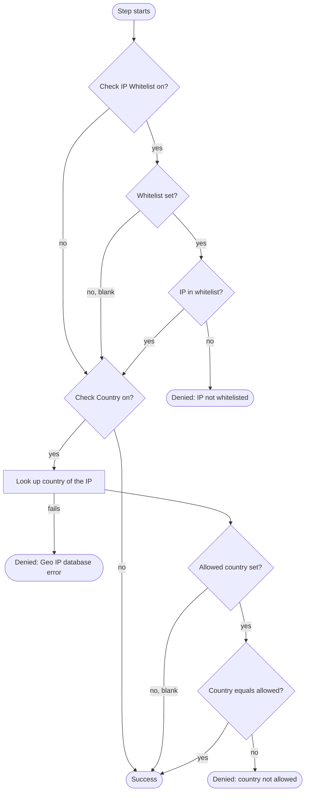

# IP Validator

Provider id `ip-validator`, shown as **IP Validator**. Class: `co.remiges.tech.ipcheckservice.ClientIPValidator`.

Blocks a login when the user's IP address is not on an allow-list, or when the IP is not in an allowed country.
It runs after the user is identified, so it can use per-user settings.

## The two checks

Each check has its own switch in the step's settings and works on its own.



An **empty** whitelist or an **empty** allowed country means "no restriction" for that check. Nobody is blocked by a check that has nothing configured.

## Where the rules come from

The rules are **attributes**, not step settings. For each check Keycloak looks at the user first, then at the client.

| Check | Attribute name | On the user | On the client |
|---|---|---|---|
| IP whitelist | `ValidIpWhitelist` | User attribute | Attribute of the client role `IPWhiteListRole` |
| Country | `ValidISOGeoLocation` | User attribute | Attribute of the client role `IPWhiteListRole` |

The user value wins. The client value is used only when the user has none.

### Set a user-level rule

1. **Users > the user > Attributes > Add attribute**.
2. Key `ValidIpWhitelist`, value for example `127.0.0.1-127.0.0.3,127.0.0.5,192.168.0.220-192.168.0.224`.
3. Key `ValidISOGeoLocation`, value a 2-letter country code such as `IN`.
4. Save.

### Set a client-level rule

1. **Clients > the client** (for the account console, `account-console`) **> Roles**.
2. Create the role **`IPWhiteListRole`** if it does not exist, and open it.
3. Open its **Attributes** and add `ValidIpWhitelist` and/or `ValidISOGeoLocation`.
4. Save.

The README of the project also mentions a role named `ValidISOGeoLocation`. The code reads both attributes
from the role **`IPWhiteListRole`**, so put them there.

## Whitelist syntax

Entries are separated by commas. Spaces around entries are ignored.

| Entry | Meaning | Example |
|---|---|---|
| Single IPv4 | An exact address | `10.0.0.1` |
| Range | From and to, inclusive | `192.168.0.220-192.168.0.224` |
| IPv6 | Compared as an address, so different spellings of the same address match | `2001:db8::1` |
| `*.*.*.*` | Any address | `*.*.*.*` |

A malformed entry is logged and ignored. It never grants access and does not stop the other entries from being checked.

## Settings

| Field | Default | Meaning |
|---|---|---|
| Check IP Whitelist | on | If off, the whitelist check is skipped. The country check still runs |
| Check Country (Geo IP) | on | If off, the country check is skipped |
| Message: IP Not Whitelisted | see below | Shown when the IP is rejected. Placeholder `{ip}` |
| Message: Country Not Allowed | see below | Placeholders `{ip}`, `{country}`, `{allowedCountry}` |
| Message: Geo IP Database Error | see below | Shown when the country cannot be found. Placeholder `{ip}` |

Default texts:

```
Your IP Address <{ip}> is not part of whitelist, therefore access is denied
Your IP Address <{ip}> belongs to <{country}> is not part of whitelisted Geo Location<{allowedCountry}> for you, therefore access is denied
GeoIP Database Error for your IP <{ip}>
```

## Requirements for the country check

- `GeoLite2-Country.mmdb`, `geoip2-4.0.1.jar` and `maxmind-db-3.0.0.jar` in the `providers/` folder
  (see [Installation](installation.md#dependencies-placed-beside-the-jar)).
- The environment variable `KC_DIR` set to the Keycloak home, because the database is read from `${KC_DIR}/providers/GeoLite2-Country.mmdb`.
- The database is loaded once and cached. After you update the file, restart Keycloak.

## How the client IP is determined

The step uses the connection's remote address as Keycloak reports it. If that is empty it falls back to the local address.
The step does **not** read `X-Forwarded-For` itself.

If Keycloak runs behind a reverse proxy, configure Keycloak's proxy headers
(`--proxy-headers xforwarded` or `forwarded`), otherwise every user appears to come from the proxy's address.

## Special cases

| Case | Behaviour |
|---|---|
| IP is `127.0.0.1` or `0:0:0:0:0:0:0:1` | The country is reported as **`IN`** without a database lookup. This makes local testing pass for an India-only rule |
| Private or unknown address | The database cannot find a country, so the user sees the Geo IP Database Error message |
| Both checks off | The step always succeeds |

## Denials

A rejected login shows an error page with the configured message. The failure type is `INTERNAL_ERROR` and the page status is 500.
The decision is also written to the log.

## Example

Allow staff only from the office network and from India:

| Where | Attribute | Value |
|---|---|---|
| Client role `IPWhiteListRole` | `ValidIpWhitelist` | `203.0.113.0-203.0.113.50` |
| Client role `IPWhiteListRole` | `ValidISOGeoLocation` | `IN` |
| One traveling user | `ValidISOGeoLocation` | `AE` (overrides the client value for this user only) |
