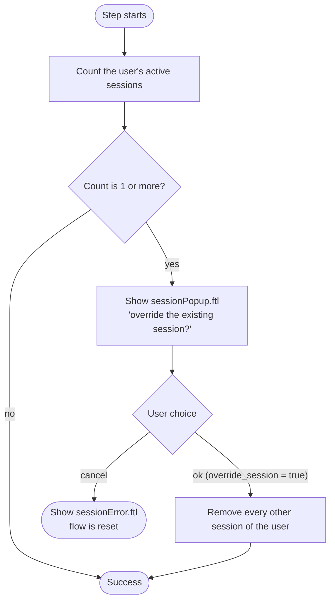

# Session Validator

Provider id `user-session-validator`, shown as **user-session-validator**.
Class: `co.remiges.tech.usersession.UserSessionAuthenticator`.

Allows **one active session per user**. When a user who already has a session logs in again, they are asked whether
to end the older session or cancel the new login.

## How it works



1. The step counts the user's sessions in the realm.
2. With no session, the login continues.
3. With one or more, the page `sessionPopup.ftl` is shown.
4. If the user confirms, the form posts `override_session=true`. Every session of the user except the current one is removed, and the login continues.
5. If the user cancels, the page `sessionError.ftl` is shown with the message `sessionExist` ("user is already logged in from another device") and the flow is reset.

For an **Alternative** or **Conditional** step, a cancel marks the step as attempted instead of failing the flow.

## Set it up

1. **Authentication > Flows**, in your browser-flow copy, click **Add step** and choose **user-session-validator**.
2. Place it **after** the OTP step and set it to **Required**.
3. Add the two templates to your login theme (see below).

The step has no settings.

## Templates you must provide

The repository does not contain these two pages. Create them in `themes/<your-theme>/login/`.

| Template | Must contain |
|---|---|
| `sessionPopup.ftl` | A form posting to `${url.loginAction}` with a field named `override_session`. A confirm button sends `true`, a cancel button sends `false` |
| `sessionError.ftl` | A page that shows the error message |

Minimal idea for `sessionPopup.ftl`:

```ftl
<#import "template.ftl" as layout>
<@layout.registrationLayout; section>
  <#if section = "form">
    <p>You are already logged in on another device. Log out there and continue here?</p>
    <form action="${url.loginAction}" method="post">
      <button name="override_session" value="true"  type="submit">Continue here</button>
      <button name="override_session" value="false" type="submit">Cancel</button>
    </form>
  </#if>
</@layout.registrationLayout>
```

## Limits and behaviour

| Item | Value |
|---|---|
| Allowed sessions | **1**, fixed in the code. There is no setting |
| Scope | All sessions of the user in the realm, on every client |
| Removing sessions | Immediate. The other device loses its session |

## Important: step order

Place this step **after the OTP step**. The popup lets the user end other sessions. If it ran before the OTP step,
anyone who knows a user's password could end that user's sessions without passing the second factor.

## Notes

- The step's help text in the admin console is only its name, `user-session-validator`.
- A session count is logged at info level, for example `Total number of sessions <1>`.
