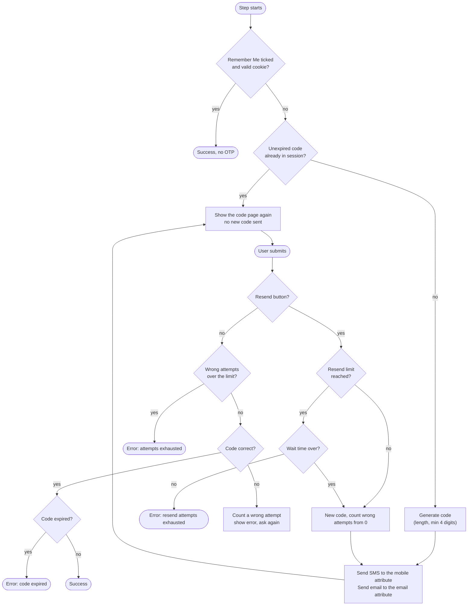

# SMS Authentication

Provider id `sms-authenticator`, shown in the admin console as **SMS Authentication**.
Class: `co.remiges.tech.smsservice.SmsAuthenticator`.

This step sends a one-time code (OTP) to the user **by SMS and by email at the same time**, then checks the code
the user types. Despite the name, the email is part of it, because the code page tells the user the code went to both.

## How it works



### In words

1. The step reads the user's mobile number and email from the **user attributes** you name in its settings.
2. It builds a random numeric code of the configured length. A configured length below 4 is raised to 4.
3. It sends the SMS through the **SMS gateway** and the email through the **email API**, using your templates.
4. It stores the code and its expiry time in the authentication session and shows the code page.
5. When the user submits, the code is compared in constant time. A correct, unexpired code ends the step.

If the user reloads the page while a valid code exists, the same code page is shown and no second code is sent.
This also stops a reload from skipping the step in an alternative or conditional flow.

## Set it up

1. Open **Authentication > Flows**. Pick **browser** and choose **Action > Duplicate**. Name it, for example, `browserWithSMSOtp`.
2. In the copy, click **Add step**, search for **SMS Authentication**, and add it after the username and password step.
3. Set its requirement to **Required** (the step also offers Alternative and Disabled).
4. Click the **gear icon** next to the step, enter an alias, and fill in the settings below. Save.
5. Make sure users have the attributes the step reads (see [User attributes](#user-attributes)).
6. Open **Action > Bind flow** and bind the new flow as the **Browser flow**.
7. Install the code page template, see [The code page](#the-code-page).

## Settings

Fields are grouped by the prefix of their label. The complete table with keys and defaults is in the
[Configuration Reference](configuration-reference.md#sms-authentication-sms-authenticator).

### Branding

| Field | Notes |
|---|---|
| Branding: Name | Fills `{brandingName}`. Blank uses the realm display name, then the realm name |

### Email (the OTP email)

| Field | Notes |
|---|---|
| Email API: URL | Mail-send URL, must match the format below |
| Email API: Key | API key, stored masked |
| Email API: Format | `legacy`, `v5` or `v6`, see [Email API formats](#email-api-formats) |
| OTP Email: Sender Name | Blank uses Branding: Name |
| OTP Email: Sender Address | **Required.** No email is sent while it is empty. The domain must be verified with your provider |
| OTP Email: Provider Tag | Tag for the provider's reports. Blank uses the sender name |
| OTP Email: Subject | Placeholders: `{brandingName}` `{firstName}` `{lastName}` `{username}` |
| OTP Email: Body | HTML allowed. Adds `{code}` and `{ttlMinutes}` |

### SMS gateway

| Field | Notes |
|---|---|
| SMS Gateway: URL | Address of the gateway |
| SMS Gateway: Feed Id | Route or feed id from the gateway provider |
| SMS Gateway: Sender Id | The sender header shown on the phone. Blank sends the gateway URL as sender id (the original behaviour) |
| SMS Gateway: Username / Password | Account credentials. The password is stored masked and never logged |
| SMS: Message Text | The SMS template. Same placeholders as the email body |

### OTP rules

| Field | Default | Meaning |
|---|---|---|
| OTP: Code Length (digits) | 6 | Raised to 4 if set lower |
| OTP: Valid For (seconds) | 300 | Lifetime of a code |
| OTP: Max Wrong Attempts | 3 | After this many wrong codes the user is stopped. A resend starts the count again |
| OTP: Max Resends | 3 | Resends allowed before the wait starts |
| OTP: Wait After Max Resends (minutes) | 30 | How long to wait once the resends are used up |

### Messages on the code page

| Field | Placeholder |
|---|---|
| Message: OTP Sent To Email | `{maskedEmail}` |
| Message: OTP Sent To Mobile | none |
| Message: No Mobile Number | none |
| Message: Resend Limit Reached | `{retryMinutes}` |

### User attributes

| Field | Default |
|---|---|
| User Attribute: Mobile Number | `mobileNumber` |
| User Attribute: Email | `email` |

Set these on the user under **Users > the user > Attributes**. A user with no mobile number gets the code by email
only, and the code page then says "No mobile number found." Any value, including a number without the country
code, is passed to the gateway as it is. There is no format validation.

### Network and testing

See [Network](#network-proxy-and-tls) and [Simulation mode](#simulation-mode-for-testing).

## The code page

The step shows the template **`login-sms.ftl`** from your login theme. The repository holds only
`login-sms.ftl-backup`, so create `login-sms.ftl` in your theme from it.

The template must post these form fields:

| Field name | Purpose |
|---|---|
| `code` | The OTP the user types |
| `resend` (a submit button) | Asks for a new code |

The step also sets two attributes your template should show:

| Attribute | Content |
|---|---|
| `isOtpSendMsgSet` | `true` right after a code was sent |
| `otpSendMsg` | The combined "sent to email / sent to mobile" line |

Example lines to add inside the form section:

```ftl
<#if isOtpSendMsgSet?? && isOtpSendMsgSet>
  <p>${otpSendMsg}</p>
</#if>
```

The error texts use these message keys, defined in `messages_en.properties`:

| Key | English text |
|---|---|
| `smsAuthCodeInvalid` | Invalid code entered, please enter it again. |
| `smsAuthCodeExpired` | The code has expired. |
| `smsOtpLimitExhausted` | Validate otp attempts exhausted |
| `smsAuthSmsNotSent` | The SMS could not be sent, because of {0} |
| `emailSendFailed` | (not defined in the file, so Keycloak shows the key itself) |
| `sessionExist` | user is already logged in from another device |

Add translations for other languages in your own theme's message files.

## SMS gateway contract

The client sends one HTTP **GET**. Every value is URL-encoded, so a `&` or `#` in the password cannot change the request.

```
{SMS Gateway: URL}?feedid=..&text=..&to=..&username=..&senderid=..&password=..&short=1
```

| Query parameter | Source |
|---|---|
| `feedid` | SMS Gateway: Feed Id |
| `text` | The rendered SMS message |
| `to` | The user's mobile attribute |
| `username` | SMS Gateway: Username |
| `senderid` | SMS Gateway: Sender Id, or the gateway URL when blank |
| `password` | SMS Gateway: Password |
| `short` | always `1` |

HTTP **200** or **202** counts as sent. Any other status is logged with the code and at most 200 characters of the response.
A network failure is logged as its exception type only, because the full message can contain the request URL with the password.

> If your gateway uses a different request shape, a code change in `SmsServiceImpl` is needed. See [Development](development.md#adding-another-sms-gateway).

### DLT templates (India)

Many Indian gateways reject texts that do not match a registered DLT template, character for character.
The default **SMS: Message Text** keeps the old wording and spacing, with only the brand name as a variable:

```
{code} is the OTP to access {brandingName} platform for user:  {firstName} {lastName} username: {username}. OTP valid for {ttlMinutes} Minutes . Pls do not share it with anyone.
```

If you change the text, change the DLT registration first.

## Email API formats

| Format | Typical URL | Key sent as | Body shape |
|---|---|---|---|
| `v5` | `https://api.pepipost.com/v5/mail/send` | header `api_key` | v5 |
| `v6` | `https://emailapi.netcorecloud.net/v6/mail/send` | header `Authorization: Bearer <key>` | v5 shape plus `priorityflag: 1` (OTP / transactional) |
| `legacy` | older Broadside-style gateway | header `api_key` | `personalizations.recipient`, `from.fromEmail`, `from.fromName`, `content`, `tags` |

The format must match the URL. HTTP **200** or **202** counts as sent. If the provider rejects the mail, the user sees an error page.

## Remember device

If **Remember Device: Enable** is on and the user ticks **Remember Me** on the login page, the step sets a signed
cookie named `COOKIE_2FA_ANSWERED` for **Remember Device: Days**. While the cookie is valid for that user,
browser (User-Agent) and IP address, the OTP step is skipped.

- The cookie is `HttpOnly` and gets the `Secure` flag only when Keycloak itself is reached over https.
- It has no server-side expiry or revocation, so it cannot be cancelled before its age ends.
- It uses Keycloak 22 classes. **Keep it off on Keycloak 26.**

## Network, proxy and TLS

| Field | Effect |
|---|---|
| Network: Use Proxy | Sends the SMS and email calls through an HTTP proxy |
| Network: Proxy Host / Port | The proxy address. The port is only read when the proxy is on |
| Network: Skip TLS Verification | Stops checking server certificates. For testing with self-signed certificates only. Anyone on the network could read the OTP and the gateway password |

## Simulation mode for testing

| Field | Effect |
|---|---|
| Testing: Simulation Mode | No SMS and no email is sent. A warning with the masked number and email is logged instead |
| Testing: Fixed OTP | Used only while simulation mode is on. Digits only, at least 4. Every user gets this code. Blank keeps random codes |

The OTP is never logged, even in simulation mode, so you need the fixed code to log in.
The fixed code is ignored when simulation mode is off. Never use either in production.

## What the user sees

| Situation | Result |
|---|---|
| Correct code | Login continues |
| Wrong code | "Invalid code entered, please enter it again." |
| Too many wrong codes | "Validate otp attempts exhausted" |
| Expired code | "The code has expired." |
| Resend limit used up | The configured text, for example "Resend otp attempts exhausted. Try after 30 minutes." |
| Gateway or email API fails | A generic error page. The cause is in the server log |

## Logging

| Logged | Not logged |
|---|---|
| Masked phone number (last 3 digits), masked email | The OTP, the gateway password, the API key |
| Gateway status code and the first 200 characters of a failure | The full exception text of a failed SMS call |
| A warning whenever simulation mode or skip-TLS is active | |

## Known behaviour to be aware of

- The OTP is kept as plain text in the authentication session until it is used or expires.
- There is no format check on the mobile number.
- `configuredFor` always returns true, so the step does not offer users a way to enrol. The mobile number must already be an attribute.
- The step expects the user to have an email. If the email attribute is empty, an error is logged and the login is failed, even when the SMS was sent. Keep the email attribute filled.
